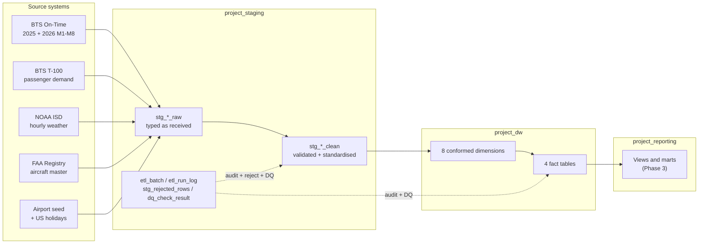
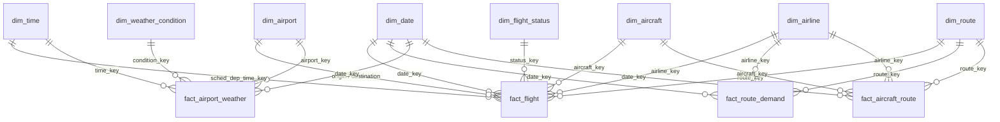
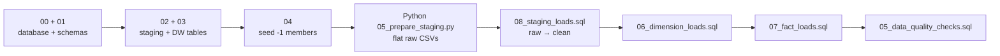

# Aviation Reliability & Performance Data Warehouse

**DL3004 — Data Warehousing & Business Intelligence | Team: Null Pointers**

An end-to-end PostgreSQL warehouse that brings together US domestic flight operations,
passenger demand, airport weather and aircraft registry data so that operations and
commercial managers can see **where delays happen, what drives them, and how reliability
relates to passenger demand**.

- Team: Farhan (23L-2589), Haris Hassaan (23L-2642), Muhammad Zuraiz Anjum (23L-2547), Zoraiz Rizwan (23L-6008)
- Repository: <https://github.com/FarhanZafarr-9/DWBI-Project.git>
- Current status: **Phase 2 complete and validated** — Phase 3 (OLAP, dashboards, insights) is next.

---

## 1. The business question

Delays and cancellations cost airlines and airports money and customer trust, but the
evidence sits in separate source systems. This project integrates four sources into
one dimensional model so that the two halves of the question can be answered together:

| Half | Question | Where it lives |
|---|---|---|
| **What affects aviation** | Carrier, weather, NAS, security, late aircraft, congestion, aircraft age/model, schedule | Delay-cause measures, weather and aircraft facts, time/aircraft dimensions |
| **How it affects** | Departure/arrival delay, cancellations, passenger and route impact | Flight fact, status dimension, route-demand fact |

Four conformed dimensions — **Date, Airport, Airline, Route** — are the join points that
make the cross-process analysis possible.

---

## 2. Architecture



Sources land in `project_staging` exactly as received, are cleaned into `stg_*_clean`,
and only then feed `project_dw`. No cleaning happens inside the warehouse layer.
Every fact uses integer surrogate keys; natural keys remain as dimension attributes.

---

## 3. Dimensional model

A constellation (galaxy) schema: **4 fact tables + 8 dimensions**. Each dimension has
a `-1` Unknown member so no fact row is ever orphaned.



| Fact | Grain | Measures |
|---|---|---|
| `fact_flight` | One scheduled flight leg, origin → destination, one date | Departure/arrival delay, 5 delay causes, taxi, air time, distance, cancelled/diverted |
| `fact_route_demand` | One airline on one route in one month | Passengers, seats, departures (load factor derived) |
| `fact_airport_weather` | One hourly observation at one airport | Temperature, visibility, wind, precipitation |
| `fact_aircraft_route` | One aircraft on one route on one date | None — factless, rows are counted |

---

## 4. Repository layout

```text
DWBI-Project/
├── README.md                    # this file
├── PROJECT_CONTEXT.md           # working context and source caveats
├── SUBMISSION_REPORT.md         # Phase 2 load + validation summary
├── reference.md                 # original intent vs Phase 2 results vs Phase 3 plan
├── Phase1/
│   ├── 01_Project_Documentation/  # proposal, requirements, 10 questions, grain, schema
│   └── 02_Data_Pack/              # reference CSVs + Python download/build/verify scripts
└── Phase2/
    ├── 00_create_database.sql
    ├── 01_create_schemas.sql
    ├── 02_staging_tables.sql
    ├── 03_dw_tables.sql
    ├── 04_seed_dimensions.sql
    ├── 05_data_quality_checks.sql
    ├── 06_dimension_loads.sql
    ├── 07_fact_loads.sql
    ├── 08_staging_loads.sql
    ├── 99_reset_database.sql      # destructive: drops all project schemas
    ├── DATA_CLEANING_REPORT.md / Data_Cleaning_Report.pdf
    └── DATA_QUALITY_REPORT.md  / Data_Quality_Report.pdf
```

Large raw source files are gitignored; only scripts, reference CSVs, SQL and reports
are version-controlled.

---

## 5. Build and load

Requires PostgreSQL 18 and psql. All scripts are re-runnable.

```bash
pip install -r Phase1/02_Data_Pack/requirements.txt
python Phase1/02_Data_Pack/scripts/05_prepare_staging.py --batch-id 1
psql -d aviation_dw -f Phase2/08_staging_loads.sql
```

Full script order:



`05` is numbered earlier but must run **last**: it checks the loaded data. `99` is an
optional teardown script. See `Phase2/README.md` for the detailed run notes and the
hardcoded CSV path in `08_staging_loads.sql` (edit it if your checkout lives elsewhere).

---

## 6. What is loaded

Validated on an isolated PostgreSQL 18 instance. Coverage: **2025-01 to 2026-08 (20 months)**.

| Layer | Table | Rows |
|---|---|---:|
| Clean | `stg_flight_clean` | 11,730,351 |
| Clean | `stg_route_demand_clean` | 601,435 |
| Clean | `stg_weather_clean` | 264,364 |
| Clean | `stg_aircraft_clean` | 319,417 |
| DW | `dim_date` / `dim_time` / `dim_airline` / `dim_airport` | 731 / 25 / 15 / 2,036 |
| DW | `dim_route` / `dim_aircraft` / `dim_flight_status` / `dim_weather_condition` | 7,345 / 319,418 / 5 / 3 |
| DW | `fact_flight` *(sampled)* | 469,214 |
| DW | `fact_route_demand` | 232,281 |
| DW | `fact_airport_weather` | 171,225 |
| DW | `fact_aircraft_route` *(sampled)* | 99,950 |

Clean staging, route demand, weather and all dimensions are **full loads**. The two
large flight-based facts use a deterministic systematic sample (`raw_id % 25 = 0`,
no `LIMIT`) because the full 11.7 M-row join exhausted local disk. The sample covers
all 20 published months; the committed `07_fact_loads.sql` is the full-load script for
a machine with adequate disk.

### Data quality

**28 checks — 27 passed, 1 warning, 0 failures.** All 19 referential-integrity checks
returned 0 orphan rows. The single warning is the flight reconciliation check
(469,214 sampled vs 11,730,351 clean rows), which is the documented sampling decision.
Anomaly found and fixed: cancelled flights no longer carry delay measures — all
8,229 cancelled flights keep their `CANCELLED` status with delay columns set to `NULL`.

```sql
SELECT check_name, severity, observed, expected, passed
FROM project_staging.dq_check_result
ORDER BY passed, check_name;
```

---

## 7. Known limitations

- 2026 On-Time and T-100 end in August — compare like-for-like M1–M8 only.
- NOAA weather ends 2025-08-27 and is UTC-hour grain; no 2026 weather and no weather YoY.
- DB1B covers 2025 Q1–Q2 only; fare analysis was out of scope.
- 16,448 facts use the `-1` Unknown member; `UNK-UNK` (261 T-100 rows, 14.8 M passengers)
  is the Unknown route, not a real route — exclude it from business rankings.
- FAA is a single current registry snapshot; historical aircraft attributes are approximate.
- `project_reporting` exists but is empty — dashboards and marts are Phase 3.

---

## 8. Phase 3 roadmap

The Phase 2 gaps above are inputs to Phase 3, not failures:

- Analytical SQL Queries — airline/route rankings, delay causes by season, aircraft age
- OLAP Queries — roll-up, drill-down, slice and dice via the Date and Airport hierarchies
- Reporting Views — `project_reporting` views, including the high-demand / low-reliability join
- Indexing Report — built on the 8 indexes and 24 monthly partitions already in `03_dw_tables.sql`
- Power BI Dashboard + screenshots — BR7 and the 10 business questions
- Business Insights Report + final presentation — the "what affects / how it affects" story

See `reference.md` for the full Phase 1 intent → Phase 2 delivery → Phase 3 handover mapping.
